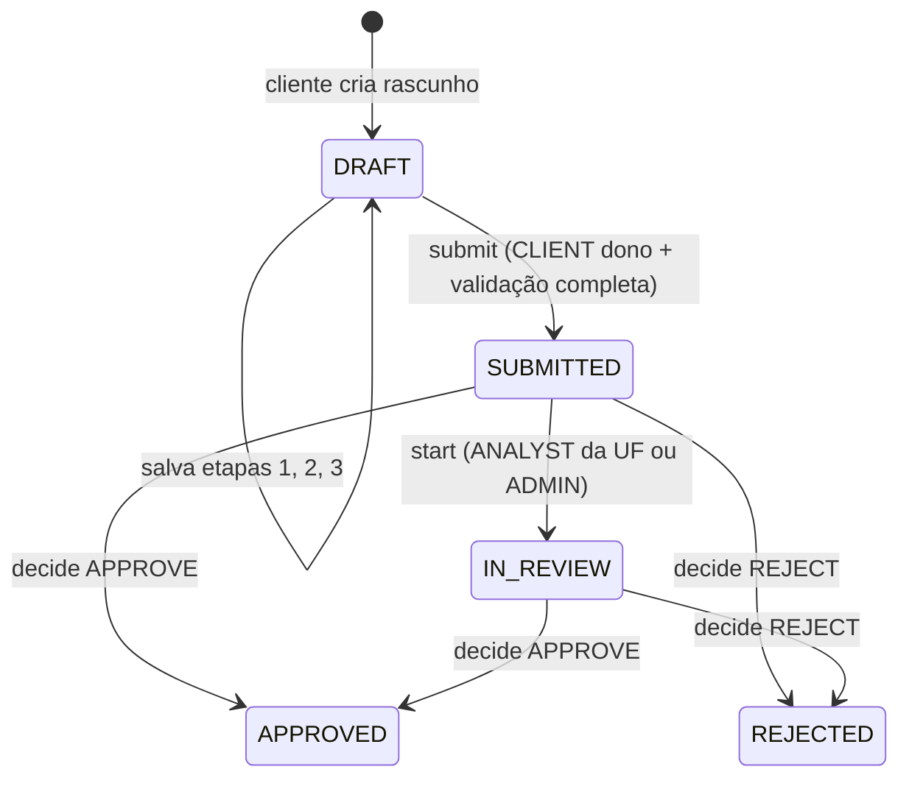
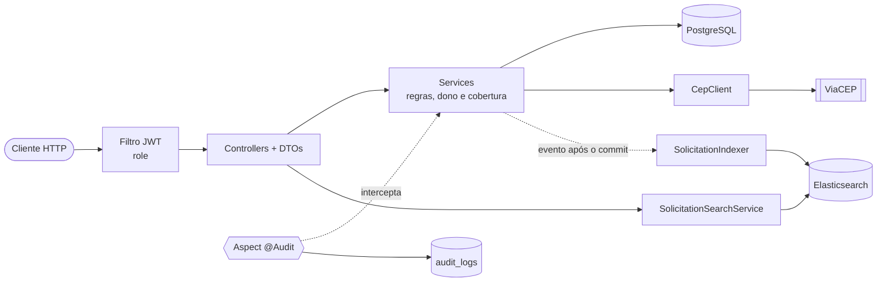

# Desafio Backend SEA - API de Solicitações de Atendimento

API REST (somente backend) para gerenciar **Solicitações de Atendimento**. Um cliente preenche uma solicitação em 3
etapas (podendo salvar rascunho) e a envia. Um analista que cobre a UF do endereço analisa e aprova ou rejeita. Tudo é
buscável no Elasticsearch e as ações críticas são auditadas via AOP.

## Stack

| Item                  | Tecnologia                                      |
|-----------------------|-------------------------------------------------|
| Linguagem / framework | Java 21 + Spring Boot 4                         |
| Persistência          | PostgreSQL (migrations com Flyway)              |
| Busca                 | Elasticsearch                                   |
| Autenticação          | JWT (controle por role, dono e UF)              |
| Validação             | Bean Validation, com erros JSON padronizados    |
| Auditoria             | AOP com `@Audit`, gravando em `audit_logs`      |
| Testes                | JUnit 5, Mockito e Testcontainers               |
| Documentação          | OpenAPI / Swagger UI (springdoc)                |
| Métricas              | Micrometer (Actuator), formato Prometheus       |
| Infra                 | Docker Compose (app + postgres + elasticsearch) |

## Como subir o projeto com Docker Compose

Pré-requisito: Docker com o Compose v2.

1. **Crie o arquivo `.env`** a partir do modelo e troque os segredos:

   ```bash
   cp .env.example .env
   ```

   | Variável             | Descrição                                                                                | Padrão               |
   |----------------------|------------------------------------------------------------------------------------------|----------------------|
   | `JWT_SECRET`         | Segredo usado para assinar os tokens, com pelo menos 32 caracteres (obrigatório)         | —                    |
   | `JWT_EXPIRATION`     | Validade do token, em segundos                                                           | `3600`               |
   | `JWT_ISSUER`         | Emissor gravado nos tokens                                                               | `desafiobackend-sea` |
   | `ADMIN_EMAIL`        | Email do **primeiro ADMIN**, criado pela migration `V2` na primeira subida (obrigatório) | —                    |
   | `ADMIN_PASSWORD`     | Senha desse ADMIN (obrigatória)                                                          | —                    |
   | `SPRINGDOC_ENABLED`  | Liga ou desliga o Swagger UI e o `/v3/api-docs` (opcional)                               | `true`               |

2. **Suba tudo** (app, PostgreSQL e Elasticsearch):

   ```bash
   docker compose up --build
   ```

   O serviço `app` só inicia depois que o banco e o Elasticsearch passam no healthcheck, e a própria aplicação tem um
   healthcheck (`/actuator/health`, que também reflete a saúde do banco e do Elasticsearch). O `compose.dev.yaml` é só para desenvolvimento (veja "Rodando pela IDE") e o Docker Compose não o usa
   por padrão.

3. **Acesse a API** em `http://localhost:8080`. A documentação interativa (**Swagger UI**) fica em
   `http://localhost:8080/swagger-ui.html`, e o JSON OpenAPI em `http://localhost:8080/v3/api-docs`. Para chamar as
   rotas protegidas pelo Swagger UI: faça o login em `POST /auth/login`, copie o token e use o botão **Authorize**.
   As métricas ficam em `http://localhost:8080/actuator/metrics` (lista) e `http://localhost:8080/actuator/prometheus`
   (formato Prometheus); o `health` fica em `/actuator/health`.

| Serviço                                         | Porta                         |
|-------------------------------------------------|-------------------------------|
| app (Spring Boot)                               | 8080                          |
| PostgreSQL (`mydatabase` / `myuser` / `secret`) | só na rede interna do Compose |
| Elasticsearch                                   | só na rede interna do Compose |

Para parar tudo, use `docker compose down`. Acrescente `-v` para apagar também os volumes de dados.

### Rodando pela IDE (sem containerizar o app)

Com o `.env` criado, rode `DesafiobackendSeaApplication`. O `spring-boot-docker-compose` sobe o Postgres e o
Elasticsearch a partir do `compose.dev.yaml` (que publica as portas em valores aleatórios do host; veja com
`docker compose -f compose.dev.yaml ps`), e o Spring lê o `.env` da raiz do projeto. É preciso ter o JDK 21 (há um
`.sdkmanrc` com Temurin 21: `sdk env install`).

## Primeiros passos

O ADMIN inicial é o do `.env` (`ADMIN_EMAIL` / `ADMIN_PASSWORD`). A partir dele, o fluxo completo é:

1. `POST /auth/login` como **ADMIN** e guarde o token.
2. `POST /admin/users` com `"role": "ANALYST"` e `coverageUfs` (por exemplo `["SP", "DF"]`) para criar um analista.
3. `POST /auth/register` para criar um **CLIENT** e `POST /auth/login` para obter o token dele.
4. Como CLIENT: `POST /solicitations`, depois `PUT /solicitations/{id}/steps/1`, `/2`, `/3` e `POST .../submit`.
5. Como ANALYST (ou ADMIN): `POST /analyst/solicitations/{id}/start` e `POST .../decide`.
6. `GET /analyst/solicitations/search?q=...` para buscar.

A pasta [`http/`](http) tem esse fluxo pronto, com os casos de erro, para o HTTP Client do IntelliJ/VS Code. Escolha o
ambiente `local` (`http-client.env.json`) e rode as requisições de cada arquivo de cima para baixo:

| Arquivo              | O que mostra                                                                                                                  |
|----------------------|-------------------------------------------------------------------------------------------------------------------------------|
| `users.http`         | Criar ANALYST e ADMIN, cobertura por UF e os casos de erro                                                                    |
| `auth.http`          | Cadastro e login                                                                                                              |
| `solicitations.http` | Fluxo do cliente: rascunho, as 3 etapas, submit e erros                                                                       |
| `analyst.http`       | Fluxo do analista (ver, iniciar, decidir) e o ADMIN analisando qualquer UF. Cria os próprios usuários e dados                  |
| `search.http`        | A busca: texto livre, filtros, paginação, ordenação, parâmetros inválidos e quem pode buscar. Cria os próprios usuários e dados |

`analyst.http` e `search.http` só dependem do ADMIN do `.env` (as variáveis `admin_email` e `admin_password` no topo
deles trazem os valores do `.env.example`; ajuste se os seus forem outros).

## Perfis de acesso (RBAC)

| Perfil      | Pode                                                                                                | Restrições                                                               |
|-------------|-----------------------------------------------------------------------------------------------------|--------------------------------------------------------------------------|
| **CLIENT**  | Se cadastrar, criar, editar e enviar suas próprias solicitações                                     | Só vê e mexe no que é dele (*owner*)                                     |
| **ANALYST** | Ver, iniciar análise e decidir solicitações; buscar                                                 | Somente das UFs que cobre (*coverage*)                                   |
| **ADMIN**   | Faz tudo: cria usuários internos, define as UFs dos analistas e **também analisa** (em qualquer UF) | Não usa as rotas do cliente (não é dono); rascunhos continuam invisíveis |

A segurança tem três dimensões: **role**, **dono** e **UF**. A role vem do JWT; o dono e a cobertura são verificados nos
services (veja as decisões de design).

## Domínio: a Solicitação

### Ciclo de vida



- **DRAFT** é o único status em que a solicitação pode ser editada.
- **start** é opcional (recomendado), por isso `decide` também parte de `SUBMITTED`.
- Transições inválidas são rejeitadas com `409`, por exemplo decidir uma solicitação ainda em `DRAFT` ou enviar duas vezes.

### Etapas de preenchimento

`currentStep` avança a cada etapa concluída, e o cliente pode salvar o rascunho e retomar de onde parou.

| Etapa                | Campos                                                         | Regras                                                                                                                                                                                          |
|----------------------|----------------------------------------------------------------|-------------------------------------------------------------------------------------------------------------------------------------------------------------------------------------------------|
| **1. Dados básicos** | `serviceType`, `title`, `description`                          | `serviceType` ∈ `INSTALLATION`, `MAINTENANCE`, `INSPECTION`; `title` de 3 a 80 caracteres; `description` de 20 a 1000 (ambos com *trim*)                                                        |
| **2. Endereço**      | `cep`, `number`, `complement`                                  | O CEP é consultado no **ViaCEP**, que preenche rua, bairro, cidade e UF; `number` de 1 a 20 caracteres; `complement` é opcional. CEP inválido ou ViaCEP fora do ar: a etapa **não** é concluída |
| **3. Confirmação**   | `priority`, `preferredDate`, `estimatedValue`, `termsAccepted` | `priority` ∈ `LOW`, `MEDIUM`, `HIGH`; `preferredDate` é opcional, mas não pode ser passada; `estimatedValue` é obrigatório e ≥ 0; `termsAccepted` deve ser `true`; se `priority = HIGH`, então `estimatedValue ≥ 100` |

### Submit e decisão

- O **submit** só vale para o CLIENT dono, com status `DRAFT`. Ele valida todas as etapas e, se algo faltar, a resposta
  lista os campos e as etapas faltantes (`missingSteps` e `fieldErrors`).
- A **decisão** é `APPROVE` ou `REJECT`, com comentário obrigatório de 10 a 1000 caracteres. A solicitação guarda quem
  decidiu (`decidedBy`) e o comentário.

## Endpoints

### Previstos no enunciado

| Método | Rota                                 | Quem                          | Regra                                                                                                    |
|--------|--------------------------------------|-------------------------------|----------------------------------------------------------------------------------------------------------|
| POST   | `/auth/register`                     | Público                       | Cria apenas CLIENT                                                                                       |
| POST   | `/admin/users`                       | ADMIN                         | Cria ANALYST/ADMIN. ANALYST exige ao menos uma UF em `coverageUfs`; ADMIN não tem UF                     |
| POST   | `/solicitations/{id}/submit`         | CLIENT dono                   | Status deve ser `DRAFT`; validação completa                                                              |
| GET    | `/analyst/solicitations/{id}`        | ANALYST (UF coberta) ou ADMIN | Nunca devolve rascunho                                                                                   |
| POST   | `/analyst/solicitations/{id}/start`  | ANALYST (UF coberta) ou ADMIN | `SUBMITTED` → `IN_REVIEW`                                                                                |
| POST   | `/analyst/solicitations/{id}/decide` | ANALYST (UF coberta) ou ADMIN | `APPROVE`/`REJECT` + comentário (10–1000)                                                                |
| GET    | `/analyst/solicitations/search`      | ANALYST (UF coberta) ou ADMIN | Filtros: `q`, `status`, `serviceType`, `priority`, `state`, `dateFrom`, `dateTo`, `page`, `size`, `sort` |

### Complementares, para completar o fluxo

| Método | Rota                          | Quem        | Função                             |
|--------|-------------------------------|-------------|------------------------------------|
| POST   | `/auth/login`                 | Público     | Retorna o JWT                      |
| POST   | `/solicitations`              | CLIENT      | Cria rascunho (`DRAFT`)            |
| PUT    | `/solicitations/{id}/steps/1` | CLIENT dono | Salva dados básicos                |
| PUT    | `/solicitations/{id}/steps/2` | CLIENT dono | Salva endereço (consulta o ViaCEP) |
| PUT    | `/solicitations/{id}/steps/3` | CLIENT dono | Salva confirmação                  |
| GET    | `/solicitations/{id}`         | CLIENT dono | Cliente vê a sua solicitação       |
| PUT    | `/admin/users/{id}/coverage`  | ADMIN       | Define as UFs do analista          |

### Busca

`GET /analyst/solicitations/search`

| Parâmetro                           | Descrição                                                                          | Padrão             |
|-------------------------------------|------------------------------------------------------------------------------------|--------------------|
| `q`                                 | Texto livre em `title` e `description` (o título pesa mais)                        | —                  |
| `status`, `serviceType`, `priority` | Filtros exatos                                                                     | —                  |
| `state`                             | UF. Só **restringe**: é cruzada com a cobertura de quem busca                      | —                  |
| `dateFrom`, `dateTo`                | Intervalo (inclusivo, em UTC) sobre a data de envio (`submittedAt`)                | —                  |
| `page`, `size`                      | Paginação (`page` ≥ 0, `size` de 1 a 100)                                          | `0`, `20`          |
| `sort`                              | `<campo>,<asc ou desc>`, com campo em `submittedAt`, `createdAt` ou `estimatedValue` | `submittedAt,desc` |

A resposta traz `items`, `page`, `size`, `sort` e `total`.

## Regras de segurança

1. O register nunca cria ADMIN ou ANALYST.
2. O CLIENT só acessa solicitações em que `ownerId == usuário logado`.
3. O ANALYST só acessa solicitações cuja UF está na sua cobertura. O ADMIN não tem restrição de UF.
4. Na busca, o backend **força o filtro de UF = cobertura**: o `state` enviado só pode restringir ainda mais. Pedir uma
   UF fora da cobertura devolve resultado **vazio**, e nenhum dado vaza.
5. **Rascunhos nunca aparecem** para analista ou admin (nem na leitura, nem na busca, mesmo com `status=DRAFT`).
6. Só é possível editar com `status == DRAFT`.
7. O submit só vale para o dono e só em `DRAFT`.
8. "Não existe", "não é seu" e "fora da sua cobertura" respondem exatamente o mesmo `404`, para não revelar quais ids existem.
9. As rotas do Actuator (`health`, `info`, `metrics` e `prometheus`) ficam **públicas** por ser um teste técnico, e só essas
   quatro estão expostas (`env`, `beans` e afins não). Em produção seriam restritas ao ADMIN.

## Erros padronizados

Todo erro da API, inclusive `401` e `403` do Spring Security, sai neste formato:

```json
{
  "timestamp": "2026-11-02T16:00:00.123Z",
  "status": 400,
  "code": "VALIDATION_ERROR",
  "message": "Validation failed",
  "fieldErrors": [
    { "field": "title", "message": "title deve ter entre 3 e 80 caracteres" }
  ],
  "path": "/solicitations/7/steps/1"
}
```

O submit incompleto acrescenta `missingSteps` (por exemplo `[2, 3]`), e `fieldErrors` lista os campos faltantes.

| HTTP | `code`                                                                                                                                |
|------|---------------------------------------------------------------------------------------------------------------------------------------|
| 400  | `VALIDATION_ERROR`, `MALFORMED_REQUEST`, `INVALID_DATA`, `INVALID_CEP`, `INVALID_ROLE`, `INVALID_COVERAGE`, `INCOMPLETE_SOLICITATION` |
| 401  | `UNAUTHORIZED` (sem token ou token inválido), `INVALID_CREDENTIALS`                                                                   |
| 403  | `FORBIDDEN`                                                                                                                           |
| 404  | `NOT_FOUND`                                                                                                                           |
| 409  | `INVALID_STATE` (transição ou ordem de etapas inválida), `EMAIL_ALREADY_REGISTERED`                                                   |
| 503  | `CEP_SERVICE_UNAVAILABLE` (ViaCEP fora do ar)                                                                                         |
| 500  | `INTERNAL_ERROR` (sem detalhes internos; o erro é logado)                                                                             |

Demais erros do Spring MVC (rota inexistente, método não permitido) usam o mesmo formato, com `NOT_FOUND` ou `REQUEST_ERROR`.

## Arquitetura



- **Organização por funcionalidade**, com `controller` → `service` → `repository` e DTOs separados das entidades:

  | Pacote                 | Responsabilidade                                                          |
  |------------------------|---------------------------------------------------------------------------|
  | `auth`                 | Cadastro, login, JWT e o filtro de autenticação                           |
  | `users`                | Usuários, papéis e criação de ANALYST/ADMIN                               |
  | `coverage`             | Cobertura por UF: `Coverage`, `CoverageGuard` e a validação de UF         |
  | `solicitation`         | O domínio: entidade, máquina de estados, enums e exceções                 |
  | `solicitation.client`  | Fluxo do cliente (rascunho, etapas, submit)                               |
  | `solicitation.analyst` | Fluxo do analista (ver, iniciar, decidir)                                 |
  | `cep`                  | Consulta de CEP: a interface `CepClient` e a implementação `ViaCepClient` |
  | `search`               | Documento do Elasticsearch, indexação e busca                             |
  | `audit`                | `@Audit`, o aspecto e a entidade `audit_logs`                             |
  | `exception`            | Formato padronizado de erro e o `GlobalExceptionHandler`                  |
  | `config`               | Configuração de segurança                                                 |

- **Máquina de estados** da solicitação concentrada na entidade `Solicitation`, fora dos controllers e dos services.
- **ViaCEP** fica atrás da interface `CepClient` (timeout de 3 s), o que facilita o mock nos testes.
- **Indexação no Elasticsearch** por evento: os services publicam um `SolicitationChangedEvent` ao criar, ao salvar
  etapas, no submit, no start e na decisão, e o `SolicitationIndexer` indexa **depois do commit**.
- **Auditoria:** `@Audit` + `@Aspect` gravam em `audit_logs` (register, criar usuário, submit, start e decide).

### Modelo de dados

- **tb_users**: `id`, `email` (único), `password_hash`, `role`
- **tb_user_coverage**: `user_id`, `uf` (as UFs de cada analista)
- **tb_solicitations**: `id`, `owner_id`, `status`, `current_step`, os campos das 3 etapas, `decision_comment`,
  `decided_by`, `created_at`, `updated_at`, `submitted_at`
- **audit_logs**: `id`, `occurred_at`, `actor` (email, ou `anonymous`), `action`, `resource_type`, `resource_id`,
  `outcome` (`SUCCESS` ou `FAILURE`), `error_type`

As migrations (`V1` a `V5`) ficam em `src/main/resources/db/migration`; a `V2` cria o primeiro ADMIN com os valores do `.env`.

O índice `solicitations` do Elasticsearch guarda `title` e `description` como `text` (para o filtro `q`); `status`,
`serviceType`, `priority`, `state` e `city` como `keyword`; `estimatedValue` como `scaled_float` (centavos); as datas
como `date`; e `ownerId` e `decidedBy`. O Postgres continua sendo a fonte da verdade.

## Decisões de design

1. **`currentStep`** é o passo em que o cliente está: começa em 1, salvar o passo N leva a N+1 (no máximo 3) e **nunca
   retrocede**. As etapas precisam ser salvas em ordem; pular uma devolve `409`.
2. **Reeditar uma etapa já concluída é permitido enquanto for `DRAFT`**, sem invalidar as seguintes. O submit valida
   tudo no final.
3. **A UF da solicitação vem do ViaCEP**, nunca do cliente. Aceitar a UF do corpo permitiria alguém se declarar em outro
   estado para cair em outra cobertura.
4. **A cobertura é lida do banco a cada requisição**, e não de uma claim do JWT. Assim, uma mudança de cobertura vale na
   hora, sem esperar o token expirar.
5. **O `404` é o mesmo para "não existe", "não é seu" e "fora da cobertura"** (regra de segurança 8).
6. **O `state` da busca só restringe a cobertura.** O enunciado pede que o filtro de UF seja forçado à cobertura "mesmo
   que a requisição envie outro `state`". A interpretação adotada é a interseção: um `state` fora da cobertura dá
   resultado vazio, nunca dados de outra UF.
7. **O ADMIN "faz tudo"**: além de administrar usuários e cobertura, analisa solicitações de **qualquer UF** (a
   cobertura dele é irrestrita). Continua sem acesso às rotas do cliente, porque não é o dono, e rascunhos seguem
   invisíveis.
8. **Rascunhos são indexados, mas nunca devolvidos.** O enunciado manda indexar ao criar; o filtro `status != DRAFT` é
   aplicado pelo servidor em toda busca, e o analista não consegue removê-lo.
9. **Indexação depois do commit e tolerante a falhas.** O evento só é tratado quando a transação confirma (nada que sofreu
   rollback chega ao índice), e uma falha do Elasticsearch é logada sem derrubar a gravação no Postgres.
10. **Auditoria por AOP, por fora da transação.** O aspecto só vê resultados definitivos, registra **sucesso e falha**
    (uma tentativa negada fica registrada mesmo com o rollback) e nunca deixa um erro da própria gravação alterar o
    resultado do negócio. O id do recurso vem de uma expressão SpEL na anotação
    (`@Audit(action = ..., resourceId = "#id")`).
11. **`preferredDate` é opcional**, mas não pode ser passada. **`estimatedValue` é obrigatório** (≥ 0); a regra
    `HIGH ≥ 100` fica no domínio, porque depende de dois campos.
12. **Validação de formato nos DTOs** (Bean Validation) e **regras de estado e de ordem no domínio**.

## Limitações conhecidas

- **O ViaCEP é chamado dentro da transação** de salvar o endereço. Com o timeout de 3 s isso é aceitável aqui; em
  produção a consulta seria feita antes de abrir a transação.
- **O índice é eventualmente consistente.** Se a indexação falhar, o documento fica desatualizado até a próxima alteração
  daquela solicitação. Não há reindexação automática.
- **A busca respeita o limite padrão do Elasticsearch** de 10.000 resultados por consulta (`page * size`); não há
  tratamento específico para ir além disso.
- **JWT sem revogação**: não há logout nem refresh token; o token vale até expirar (`JWT_EXPIRATION`).
- **`audit_logs` só é escrita**: não há endpoint para consultá-la.
- **Dependência circular** entre os pacotes `coverage` e `users` (o `CoverageGuard` lê `UserRepository`, e `users` usa a
  validação de UF de `coverage`).

## Testes

```bash
./mvnw test
```

São cerca de 260 testes, entre unitários (regras de domínio, máquina de estados, validações, serviços, aspecto de
auditoria) e de integração do fluxo completo (cadastro → rascunho → submit → analista decide, segurança, busca, erros e
auditoria).

Os testes de integração sobem a aplicação inteira contra **PostgreSQL 18 e Elasticsearch 9.3.3 reais, em containers
(Testcontainers)**, e só o ViaCEP é simulado, então precisam de **Docker**. A primeira execução baixa as imagens. Para
rodar apenas os testes que não usam Docker:

```bash
./mvnw test -Dtest='!*IntegrationTest,!DesafiobackendSeaApplicationTests'
```

## Extras

- **Entregues:** a tabela `audit_logs`, a documentação OpenAPI/Swagger (springdoc) e as métricas com Micrometer.

## Status

O escopo funcional do enunciado está implementado e testado: autenticação com JWT e RBAC por role, dono e UF, fluxo do
cliente em 3 etapas com ViaCEP, fluxo do analista, indexação e busca no Elasticsearch, erros padronizados, auditoria via
AOP, documentação OpenAPI/Swagger, métricas e Docker Compose.
