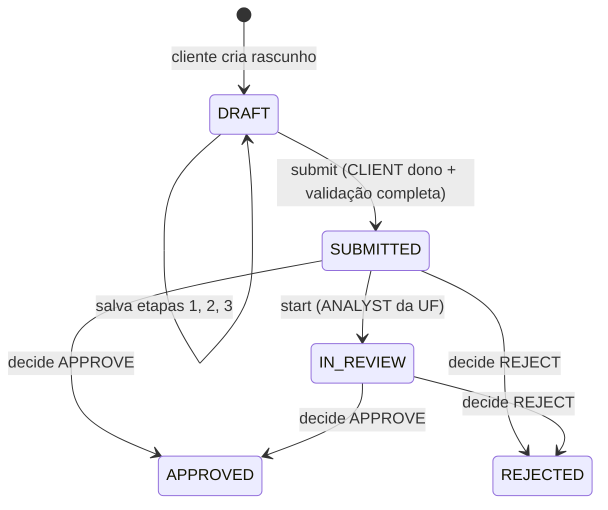
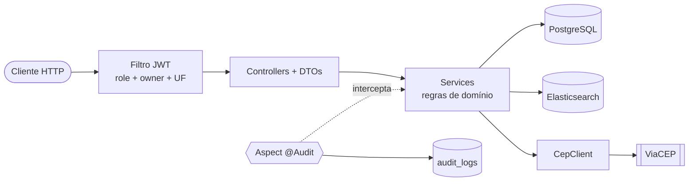

# Desafio Backend SEA — API de Solicitações de Atendimento

API REST (somente backend) para gerenciar **Solicitações de Atendimento**. Um cliente preenche uma solicitação em 3
etapas (podendo salvar rascunho) e a envia. Um analista que cobre a UF do endereço analisa e aprova ou rejeita. Tudo é
buscável no Elasticsearch e as ações críticas são auditadas via AOP.

## Stack

| Item                  | Tecnologia                                      |
|-----------------------|-------------------------------------------------|
| Linguagem / framework | Java 21 + Spring Boot 4                         |
| Persistência          | PostgreSQL (migrations com Flyway)              |
| Busca                 | Elasticsearch                                   |
| Autenticação          | JWT (controle por role, dono e UF)              |
| Validação             | Bean Validation, com erros JSON padronizados    |
| Auditoria             | AOP com `@Audit`                                |
| Infra                 | Docker Compose (app + postgres + elasticsearch) |

## Como subir o projeto com Docker Compose

Pré-requisito: Docker com o Compose v2.

1. **Crie o arquivo `.env`** a partir do modelo e troque o segredo do JWT:

   ```bash
   cp .env.example .env
   ```

   | Variável | Descrição | Padrão |
         |---|---|---|
   | `JWT_SECRET` | Segredo usado para assinar os tokens (obrigatório) | — |
   | `JWT_EXPIRATION` | Expiração do token | `36000` |

2. **Suba tudo** (app, PostgreSQL e Elasticsearch):

   ```bash
   docker compose up --build
   ```

   O serviço `app` só inicia depois que o banco e o Elasticsearch passam no healthcheck. O `compose.dev.yaml` é só para
   desenvolvimento (veja "Rodando pela IDE") e o Docker Compose não o usa por padrão.

3. **Acesse a API** em `http://localhost:8080`.

| Serviço                                         | Porta                         |
|-------------------------------------------------|-------------------------------|
| app (Spring Boot)                               | 8080                          |
| PostgreSQL (`mydatabase` / `myuser` / `secret`) | só na rede interna do Compose |
| Elasticsearch                                   | 9200                          |

Para parar tudo, use `docker compose down`. Acrescente `-v` para apagar também os volumes de
dados.

### Rodando pela IDE (sem containerizar o app)

Com o `.env` criado, rode `DesafiobackendSeaApplication`. O `spring-boot-docker-compose` sobe o Postgres e o
Elasticsearch a partir do `compose.dev.yaml`, e o Spring lê o `.env` da raiz do projeto. É preciso ter o JDK 21 (há um
`.sdkmanrc` com Temurin 21: `sdk env install`).

## Perfis de acesso (RBAC)

| Perfil      | Pode                                                            | Restrições                             |
|-------------|-----------------------------------------------------------------|----------------------------------------|
| **CLIENT**  | Se cadastrar, criar, editar e enviar suas próprias solicitações | Só vê e mexe no que é dele (*owner*)   |
| **ANALYST** | Ver, iniciar análise e decidir solicitações                     | Somente das UFs que cobre (*coverage*) |
| **ADMIN**   | Faz tudo, cria usuários internos e define as UFs dos analistas  | —                                      |

A segurança tem três dimensões: **role**, **dono** e **UF**.

## Domínio: a Solicitação

### Ciclo de vida



- **DRAFT** é o único status em que a solicitação pode ser editada.
- **start** é opcional (recomendado), por isso `decide` também parte de `SUBMITTED`.
- Transições inválidas são rejeitadas, por exemplo decidir uma solicitação ainda em `DRAFT`.

### Etapas de preenchimento

`currentStep` avança a cada etapa concluída, e o cliente pode salvar o rascunho e retomar de onde parou.

| Etapa                | Campos                                                         | Regras                                                                                                                                                                                          |
|----------------------|----------------------------------------------------------------|-------------------------------------------------------------------------------------------------------------------------------------------------------------------------------------------------|
| **1. Dados básicos** | `serviceType`, `title`, `description`                          | `serviceType` ∈ `INSTALLATION`, `MAINTENANCE`, `INSPECTION`; `title` de 3 a 80 caracteres; `description` de 20 a 1000 (ambos com *trim*)                                                        |
| **2. Endereço**      | `cep`, `number`, `complement`                                  | O CEP é consultado no **ViaCEP**, que preenche rua, bairro, cidade e UF; `number` de 1 a 20 caracteres; `complement` é opcional. CEP inválido ou ViaCEP fora do ar: a etapa **não** é concluída |
| **3. Confirmação**   | `priority`, `preferredDate`, `estimatedValue`, `termsAccepted` | `priority` ∈ `LOW`, `MEDIUM`, `HIGH`; `preferredDate` não pode ser passada; `estimatedValue` ≥ 0; `termsAccepted` deve ser `true`; se `priority = HIGH`, então `estimatedValue ≥ 100`           |

### Submit e decisão

- O **submit** só vale para o CLIENT dono, com status `DRAFT`. Ele valida todas as etapas e, se algo faltar, a resposta
  lista os campos e etapas faltantes.
- A **decisão** do analista é `APPROVE` ou `REJECT`, com comentário obrigatório de 10 a 1000 caracteres.

## Endpoints

### Previstos no enunciado

| Método | Rota                                 | Quem        | Regra                                                                                                    |
|--------|--------------------------------------|-------------|----------------------------------------------------------------------------------------------------------|
| POST   | `/auth/register`                     | Público     | Cria apenas CLIENT                                                                                       |
| POST   | `/admin/users`                       | ADMIN       | Cria ANALYST/ADMIN                                                                                       |
| POST   | `/solicitations/{id}/submit`         | CLIENT dono | Status deve ser `DRAFT`                                                                                  |
| GET    | `/analyst/solicitations/{id}`        | ANALYST     | Só se a UF estiver na cobertura                                                                          |
| POST   | `/analyst/solicitations/{id}/start`  | ANALYST     | `SUBMITTED` → `IN_REVIEW`                                                                                |
| POST   | `/analyst/solicitations/{id}/decide` | ANALYST     | `APPROVE`/`REJECT` + comentário (10–1000)                                                                |
| GET    | `/analyst/solicitations/search`      | ANALYST     | Filtros: `q`, `status`, `serviceType`, `priority`, `state`, `dateFrom`, `dateTo`, `page`, `size`, `sort` |

A busca responde com `items`, `page`, `size`, `sort` e `total`.

### Propostos para completar o fluxo

| Método    | Rota                          | Função                             |
|-----------|-------------------------------|------------------------------------|
| POST      | `/auth/login`                 | Retorna o JWT                      |
| POST      | `/solicitations`              | Cria rascunho (`DRAFT`)            |
| PUT/PATCH | `/solicitations/{id}/steps/1` | Salva dados básicos                |
| PUT/PATCH | `/solicitations/{id}/steps/2` | Salva endereço (consulta o ViaCEP) |
| PUT/PATCH | `/solicitations/{id}/steps/3` | Salva confirmação                  |
| GET       | `/solicitations/{id}`         | Cliente vê a sua solicitação       |
| GET       | `/solicitations`              | Cliente lista as suas              |
| PUT       | `/admin/users/{id}/coverage`  | Define as UFs do analista          |

## Regras de segurança

1. O register nunca cria ADMIN ou ANALYST.
2. O CLIENT só acessa solicitações em que `ownerId == usuário logado`.
3. O ANALYST só acessa solicitações cuja UF está na sua cobertura.
4. Na busca do analista, o backend **força o filtro de UF = cobertura**, mesmo que a requisição envie outro `state`. Um
   `state` fora da cobertura não pode vazar dados.
5. Só é possível editar com `status == DRAFT`.
6. O submit só vale para o dono e só em `DRAFT`.

## Arquitetura



- **Camadas:** `controller` → `service` → `repository`, com DTOs separados das entidades.
- **Pacotes previstos:** `auth`, `user`, `solicitation`, `search`, `audit`, `integration/viacep` e `common/error`.
- **Máquina de estados** da solicitação concentrada no domínio, fora dos controllers.
- **ViaCEP** fica atrás da interface `CepClient`, o que facilita o mock nos testes.
- **Indexação no Elasticsearch** feita pela camada de serviço após persistir: ao criar, ao salvar etapas, no submit e na
  decisão.
- **Auditoria:** `@Audit` + `@Aspect` gravam em `audit_logs` (register, criar usuário, submit, start e decide).
- **Erros padronizados:** `{ timestamp, status, code, message, fieldErrors[], path }`.

### Modelo de dados

- **users**: `id`, `name`, `email` (único), `password_hash`, `role`, `created_at`
- **user_coverage**: `user_id`, `uf`
- **solicitations**: `id`, `owner_id`, `status`, `current_step`, dados das 3 etapas, `decision_comment`, `decided_by`,
  `created_at`, `updated_at`, `submitted_at`
- **audit_logs**: `id`, `actor_id`, `action`, `entity_id`, `details`, `created_at`

O índice `solicitations` do Elasticsearch guarda `title` e `description` como `text` (para o filtro `q`); `status`,
`serviceType`, `priority` e `state` como `keyword`; as datas como `date`; e `ownerId`.

## Testes

```bash
./mvnw test
```

O plano prevê testes unitários (regras, máquina de estados e validações) e um teste de integração do fluxo completo.

## Extras planejados

Documentação OpenAPI/Swagger, métricas com Micrometer e a tabela `audit_logs`.

## Status

O projeto está em desenvolvimento. A infraestrutura (Docker Compose, PostgreSQL, Elasticsearch, Flyway e configuração do
JWT) está pronta, e as funcionalidades descritas acima estão sendo implementadas.
